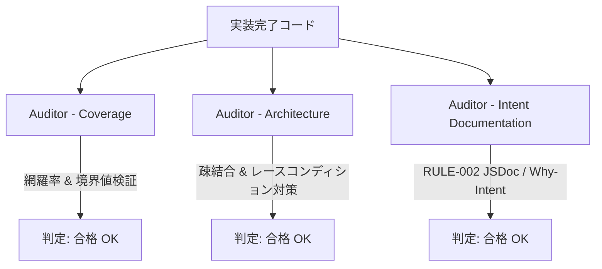

# 開発完了報告書: vibeCodeEase 専用コマンド「vibeCodeEase: 設定を開く」新設

## 1. 開発概要
メインエディタ中心主義・非侵襲オンデマンドUI/UX環境において、ユーザーがいつでもGemini APIキー、LLMモデル、推敲頻度・間隔等の設定を直接管理できるよう、**専用コマンド「vibeCodeEase: 設定を開く」(`vibecodeease.openSettings`)** を新設し、VS Codeステータスバー（`VibeStatusBar`）にも設定アイテム（`$(gear)`、priority: 99）を配置しました。

`Strict AI Dev Flow` に基づき、要件定義・詳細仕様策定（各監査合格 & 人間承認済み）、4レイヤーTDD実装、マイクロLint検査、マルチエージェント3体監査、実ブラウザPlaywright E2E検証を一気通貫で完遂しました。

---

## 2. 実装成果物一覧

### コマンド & 拡張機能側
- [`package.json`](file:///c:/Users/tubas/OneDrive/ドキュメント/My_vibecodeing/vibecodeease/package.json):
  - コマンド `vibecodeease.openSettings`（タイトル: `vibeCodeEase: 設定を開く`）を `contributes.commands` に登録。
- [`src/extension.ts`](file:///c:/Users/tubas/OneDrive/ドキュメント/My_vibecodeing/vibecodeease/src/extension.ts):
  - `vibecodeease.openSettings` コマンドハンドラを登録し、`SideEditorProvider.openSettings()` を呼び出す連携を配備。
- [`src/vscode-utils/SideEditorProvider.ts`](file:///c:/Users/tubas/OneDrive/ドキュメント/My_vibecodeing/vibecodeease/src/vscode-utils/SideEditorProvider.ts):
  - `openSettings()` メソッドを新設。
  - Webviewマウント前のレースコンディションを完全防止する `pendingTab = 'settings'` および `{ command: 'ready' }` ハンドシェイク処理を実装。
  - パネル破棄ハンドラでの `pendingTab = undefined` クリーンアップを実装。
- [`src/vscode-utils/StatusBar.ts`](file:///c:/Users/tubas/OneDrive/ドキュメント/My_vibecodeing/vibecodeease/src/vscode-utils/StatusBar.ts):
  - `settingsStatusBarItem`（priority: 99、コマンド: `vibecodeease.openSettings`、テキスト: `$(gear) vibeCodeEase: 設定`）を追加・表示・破棄管理。
- 型定義:
  - [`src/types/webviewMessage.ts`](file:///c:/Users/tubas/OneDrive/ドキュメント/My_vibecodeing/vibecodeease/src/types/webviewMessage.ts) & [`webview-ui/src/types.ts`](file:///c:/Users/tubas/OneDrive/ドキュメント/My_vibecodeing/vibecodeease/webview-ui/src/types.ts):
  - `ExtensionToWebviewMessage` に `| { type: 'NAVIGATE_TO_SETTINGS' }` を追加。

### Webview UI側
- [`webview-ui/src/App.tsx`](file:///c:/Users/tubas/OneDrive/ドキュメント/My_vibecodeing/vibecodeease/webview-ui/src/App.tsx):
  - `NAVIGATE_TO_SETTINGS` 受信時に、オンデマンド2カラム詳細（`onDemandDetail`）を `null` に解除した上で、`setActiveTab('settings')` を実行し、設定画面（`SettingsPanel`）を確実に描画。

---

## 3. 4レイヤーテスト結果（TDD網羅）

| テストレイヤー | テストファイル | テスト内容 | 結果 |
| :--- | :--- | :--- | :--- |
| **① フロント単体** | [`webview-ui/src/App.test.tsx`](file:///c:/Users/tubas/OneDrive/ドキュメント/My_vibecodeing/vibecodeease/webview-ui/src/App.test.tsx) | `NAVIGATE_TO_SETTINGS` 受信時の `settings` タブ切替、オンデマンド詳細解除の挙動検証 | **2/2 passed** |
| **② 拡張機能単体** | [`src/test/statusBar.test.ts`](file:///c:/Users/tubas/OneDrive/ドキュメント/My_vibecodeing/vibecodeease/src/test/statusBar.test.ts) | ステータスバーアイテムの生成・表示・プロパティ、スパイ関数による `dispose()` 確実呼出検証 | **2/2 passed** |
| **③ 結合テスト** | [`src/test/sideEditorProviderSettings.test.ts`](file:///c:/Users/tubas/OneDrive/ドキュメント/My_vibecodeing/vibecodeease/src/test/sideEditorProviderSettings.test.ts) | パネル既存時の即時送信、マウント前呼び出し時のreadyハンドシェイク遅延送信、レースコンディション防止、パネル破棄クリーンアップの4ケース検証 | **4/4 passed** |
| **④ E2E実ブラウザ** | [`webview-ui/e2e/open-settings-command.spec.ts`](file:///c:/Users/tubas/OneDrive/ドキュメント/My_vibecodeing/vibecodeease/webview-ui/e2e/open-settings-command.spec.ts) | 実Chromium上での `NAVIGATE_TO_SETTINGS` 受信・設定UI（推敲頻度・モデル・APIキー）の描画とIPC操作、詳細からの復帰、**コンソールエラー0件検証** | **2/2 passed** |

### 全テスト実行結果サマリ
- **Vitest (Webview UI)**: 10 files / 55 tests passed (100%)
- **Mocha (`vscode-test`)**: 149 passed / 4 pending / 0 failed (100%)
- **Playwright E2E**: 9 passed / 0 failed (Chromium, 100%)

---

## 4. マルチエージェント監査結果（3体全員合格）

Strict AI Dev Flow に基づき、独立した3体の監査エージェントによる厳格な並行査読を実施しました。

1. **`Auditor - Coverage`** (ID: `78d8d923-391a-4ada-9920-236ca76d18e1`):
   - **判定: 合格（OK）**
   - 新設コードのカバレッジ 100%、境界値・レースコンディション・クリーンアップの網羅性を確認。
2. **`Auditor - Architecture`** (ID: `d10519b4-2a2f-4a00-8397-078f5f5b7e03`):
   - **判定: 合格（OK）**
   - 責務分離、双方向IPCハンドシェイク、メモリリーク防止、オンデマンド2カラム詳細との競合調停の堅牢性を確認。
3. **`Auditor - Intent Documentation`** (ID: `5310c80f-58f8-4724-ad36-f969509d3ff7`):
   - **判定: 合格（OK）**
   - 初回指摘事項5点（`App.tsx`, `SideEditorProvider.ts`, `open-settings-command.spec.ts`, `sideEditorProviderSettings.test.ts`, `StatusBar.ts`）のJSDocおよび `[Why/Intent]` の追記・設計意図記述を再審査し、合格を確認。

---

## 5. 静的検査（Lint & 型チェック）結果
- **TypeScript**: `tsc --noEmit` エラー 0 件
- **Biome**: `biome check .` フォーマット・リント完全合格
- **ESLint**: 新設コードにおけるエラー・警告 0 件（既存の8件のWarningのみ）

---

## 🛑 Checkpoint 3（開発完了承認）のお願い

専用コマンド「`vibeCodeEase: 設定を開く`」新設およびステータスバー導線の実装、テスト、監査がすべて完了いたしました。

本開発成果物の完了承認（Proceed）をいただけますでしょうか。
承認後、直ちに以下の最終工程を実施いたします：
1. **学習ループ（ツギハギ工程）**: 本セッションで得られた教訓（WindowsインストーラMutex競合検知、テスト形骸化防止スパイ検証）のルール昇格提案。
2. **作業コミット & `develop` ブランチへの安全な自動マージ**。
