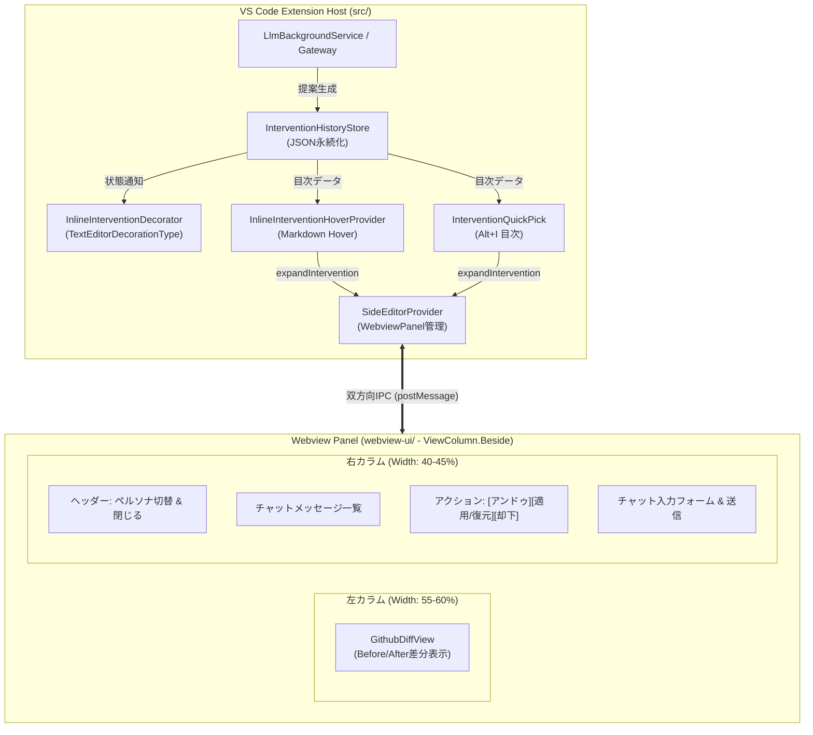

# 詳細仕様書: 非侵襲オンデマンド・インラインAIコーディングアシスタント (vibeCodeEase)

## 1. システムアーキテクチャ概要

本仕様書は、要件定義書（`docs/requirements_on_demand_inline.md`）に基づき、人間の推測やAIの脳内補完を排してテスト実装からコード実装まで完遂できるようにすべての振る舞い・インターフェース・状態遷移・ファイル構成を定義した詳細仕様書である。



---

## 2. 実装対象ファイル構成一覧

本機能の実装において追加・改定するファイル一覧とその責務：

| ファイルパス | 種別 | 責務・役割 |
|:---|:---|:---|
| `package.json` | 改定 | 新規コマンド、キーバインド（Alt+I）、コンテキストメニューの登録 |
| `src/types/onDemandIntervention.ts` | 新設 | 介入データ構造、ペルソナ型、状態遷移型の共通TypeScript型定義 |
| `src/types/onDemandIpcMessages.ts` | 新設 | 拡張機能 ↔ Webview 間の双方向IPCメッセージ型定義 |
| `src/core/onDemand/interventionHistoryStore.ts` | 新設 | 履歴のJSON永続化（`.vscode/vibecodeease/history.json`）、CRUD、状態管理 |
| `src/core/onDemand/inlineInterventionDecorator.ts` | 新設 | ヒートマップ（背景色）およびアイコン（Gutter/行末）のエディタ装飾制御 |
| `src/core/onDemand/inlineInterventionHoverProvider.ts` | 新設 | ホバー時のインライン掲示板（MarkdownString＋コマンドリンク）の生成・提供 |
| `src/core/onDemand/interventionQuickPick.ts` | 新設 | `Alt+I` 押下時の目次一覧（QuickPick）の表示と選択アクション |
| `src/core/onDemand/activeInterventionService.ts` | 新設 | ユーザー逆指名（右クリック ➜ `showInputBox` ➜ 提案生成）の統括 |
| `src/core/llm/promptBuilder.ts` | 改定 | 5大ペルソナのシステムプロンプト注入ロジックの追加 |
| `src/vscode-utils/SideEditorProvider.ts` | 改定 | オンデマンド表示制御、左右2カラム用IPCメッセージハンドリング |
| `src/extension.ts` | 改定 | 各プロバイダ・リスナー・コマンドのDI配線とライフサイクル登録 |
| `webview-ui/src/components/OnDemandSidePanel.tsx` | 新設 | Webview側のメイン画面（左右2カラム: Diff ＋ Chat・操作ペイン） |
| `webview-ui/src/components/ChatAndControlPanel.tsx` | 新設 | 右カラムのチャット一覧、ペルソナ切替、アンドゥ/復元/却下ボタン、入力欄 |
| `webview-ui/src/App.tsx` | 改定 | オンデマンドモード表示のルーティングとIPCディスパッチ |

---

## 3. `package.json` コントラクト仕様

### 3.1 コマンド (`contributes.commands`)
```json
[
  {
    "command": "vibecodeease.showInterventionSummary",
    "title": "vibeCodeEase: Show Intervention Summary"
  },
  {
    "command": "vibecodeease.expandIntervention",
    "title": "vibeCodeEase: Expand Intervention Detail"
  },
  {
    "command": "vibecodeease.discardIntervention",
    "title": "vibeCodeEase: Discard Intervention"
  },
  {
    "command": "vibecodeease.requestActiveIntervention",
    "title": "vibeCodeEase: ここを作業してコメント作成"
  }
]
```

### 3.2 キーバインド (`contributes.keybindings`)
```json
[
  {
    "command": "vibecodeease.showInterventionSummary",
    "key": "alt+i",
    "mac": "cmd+i",
    "when": "editorTextFocus"
  }
]
```

### 3.3 コンテキストメニュー (`contributes.menus`)
```json
{
  "editor/context": [
    {
      "command": "vibecodeease.requestActiveIntervention",
      "when": "editorHasSelection",
      "group": "vibecodeease@1"
    }
  ]
}
```

---

## 4. 画面レイアウト詳細仕様（UI/UX）

### 4.1 全体画面分割とサイズ比率
- **配置**: メインエディタ（左側）とオンデマンドWebview（右側: `vscode.ViewColumn.Beside`）の2画面構成。
- **Webview内部レイアウト**:
  - 親コンテナ: `display: flex; flex-direction: row; height: 100vh; overflow: hidden;`
  - 左カラム（Diffペイン）: `flex: 1 1 58%; min-width: 320px; border-right: 1px solid var(--vscode-panel-border); overflow-y: auto;`
  - 右カラム（Chat＆操作ペイン）: `flex: 1 1 42%; min-width: 280px; display: flex; flex-direction: column; height: 100%;`

### 4.2 メインエディタ装飾仕様 (`InlineInterventionDecorator`)
- **ヒートマップ装飾**:
  - `backgroundColor`: `rgba(255, 193, 7, 0.12)` (Darkテーマ), `rgba(255, 193, 7, 0.20)` (Lightテーマ)
  - `isWholeLine`: `true`
  - `overviewRulerColor`: `rgba(255, 193, 7, 0.7)` (`vscode.OverviewRulerLane.Right`)
- **アイコン装飾**:
  - 未確認状態（Pending / Reverted）:
    - Gutter: `💡` (電球アイコン)
    - 行末（After）: `contentText: " 💬 提案あり"` (色: `rgba(255, 255, 255, 0.45)`)
  - 適用済み状態（Applied）:
    - ヒートマップ: 完全消去（`undefined`）
    - Gutter: 透過チェックアイコン `[✓]` (opacity: 0.35)
    - 行末: なし
  - 却下状態（Dismissed）:
    - 装飾全消去

### 4.3 サマリー確認UI仕様

#### A. HoverProvider (`InlineInterventionHoverProvider`)
- 対象行にホバー時、以下のMarkdownを生成：
  ```markdown
  ### 💬 vibeCodeEase: AI介入提案 ({件数}件)
  ---
  **1. {title}**  
  {summary}  
  👉 [詳細差分と対話を展開](command:vibecodeease.expandIntervention?{encodedInterventionId})
  
  ---
  ❌ [この提案を却下する](command:vibecodeease.discardIntervention?{encodedInterventionId})
  ```
- **重要（引数エンコード形式）**:
  VS Code の Hover 内 `command:` URI において配列引数を渡すため、以下のようにエンコードする：
  `"command:vibecodeease.expandIntervention?" + encodeURIComponent(JSON.stringify([interventionId]))`
- `vscode.MarkdownString.isTrusted = true` を設定し、コマンド実行を許可。

#### B. QuickPick (`InterventionQuickPick`)
- コマンド `vibecodeease.showInterventionSummary`（キーバインド: `Alt+I` / `Cmd+I`）で起動。
- カーソル行（またはファイル内）の介入一覧を `QuickPickItem` としてリスト表示：
  - `label`: `$(lightbulb) {title}`
  - `description`: `L{startLine}-L{endLine}`
  - `detail`: `{summary}`
- 選択時、`vibecodeease.expandIntervention` を自動発火。
- 末尾に `$(trash) この提案をすべて却下 (Dismiss All)` を配置。

#### C. Webviewコンポーネント詳細仕様
1. **`GithubDiffView` (左カラム)**:
   - 削除行: 背景色 `rgba(248, 81, 73, 0.15)`, 先頭記号 `-`, 行番号表示
   - 追加行: 背景色 `rgba(46, 160, 67, 0.15)`, 先頭記号 `+`, 行番号表示
   - 共通行（コンテキスト）: 前後各2行を通常表示
2. **`ChatAndControlPanel` (右カラム)**:
   - **HeaderArea**:
     - ペルソナセレクタ: `<select value={personaId} onChange={...}>`（5大ペルソナ選択肢）
     - クローズボタン: `<button onClick={handleClosePanel}>✖ 閉じる</button>`（`CLOSE_SIDE_PANEL` 発行）
   - **MessageListArea**:
     - メッセージバブル: AI（左寄せ、アイコン `🤖`、コードブロックハイライト）、User（右寄せ）
     - 送信中スピナー表示（`isLoading: true` 時）
   - **ActionToolbarArea**:
     - `[⏪ 提案を取り消す (アンドゥ)]`: `status === 'applied'` の時のみ活性化
     - `[⏩ この提案を適用する (復元)]`: `status === 'pending' || status === 'reverted'` の時のみ活性化
     - `[🗑️ 提案を却下 (Dismiss)]`: 常時活性化
   - **InputArea**:
     - `<textarea>` (Shift+Enterで改行、Enterで送信)
     - `<button disabled={isLoading}>送信</button>`

---

## 5. 詳細シーケンスフロー仕様

### 5.1 能動的指示（逆指名フロー: `requestActiveIntervention`）
1. ユーザーがエディタ上でコード範囲を選択。
2. 右クリックコンテキストメニューから「vibeCodeEase: ここを作業してコメント作成」を実行。
3. 拡張機能は選択範囲（`vscode.Selection`）を取得。未選択の場合は警告表示して中断。
4. `vscode.window.showInputBox` を表示し、指示プロンプト（例:「パフォーマンス改善して」）を入力させる。キャンセル時は中断。
5. プログレス通知（`vscode.window.withProgress`）を表示。
6. `LlmGateway` を呼び出し、選択コードと指示に基づき推敲案（`originalCode`, `proposedCode`, `title`, `summary`）を生成。
7. 新規UUID（例: `int-xxxxxxxx`）を採番し、`InterventionDetail` を作成。
8. `InterventionHistoryStore.saveIntervention` で永続化。
9. `InlineInterventionDecorator.updateDecorations` を呼び出し、エディタにヒートマップとアイコンを即座に描画。
10. `SideEditorProvider.expandIntervention(interventionId)` を呼び出し、Beside Webviewを自動展開してDiffとChatを表示。

### 5.2 チャット対話の完全往復シーケンス（`SEND_CHAT_MESSAGE`）
1. Webview側でユーザーがテキストを入力し「送信」をクリック（またはEnter押下）。
2. Webviewは `SEND_CHAT_MESSAGE` (`{ interventionId, personaId, text }`) を拡張機能へ送信。
3. 拡張機能（`SideEditorProvider`）はメッセージを受信し、ユーザー発言（`sender: 'user'`）を `InterventionDetail.chatHistory` に追加。
4. Webviewへ `SET_CHAT_LOADING` (`{ interventionId, isLoading: true }`) を即時送信し、スピナーを表示。
5. `PromptBuilder.buildChatPrompt(personaId, detail, text)` により、ペルソナのシステムプロンプトおよび該当コード差分を含むプロンプトを構築。
6. `LlmGateway` へリクエスト（タイムアウト: 30秒）。
7. **正常終了時**:
   - LLM応答テキストを受信。
   - AI発言（`sender: 'ai'`）を `chatHistory` に追加。
   - `InterventionHistoryStore` でJSONファイルを更新保存。
   - Webviewへ `RECEIVE_CHAT_MESSAGE` (`{ interventionId, message }`) を送信。
   - Webviewへ `SET_CHAT_LOADING` (`{ interventionId, isLoading: false }`) を送信。
8. **異常終了（タイムアウト/エラー）時**:
   - Webviewへ `SET_CHAT_LOADING` (`{ interventionId, isLoading: false }`) を送信。
   - システムエラー発言（「⚠️ エラーが発生しました。再試行してください」）を `chatHistory` に追加し `RECEIVE_CHAT_MESSAGE` を送信。

### 5.3 Webviewパネル（`SideEditorProvider`）のシングルトン＆開閉ライフサイクル
1. **シングルトン管理**:
   - `SideEditorProvider` は `private currentPanel: vscode.WebviewPanel | undefined` を保持。
2. **展開処理 (`expandIntervention`)**:
   - `currentPanel` が存在する場合: `this.currentPanel.reveal(vscode.ViewColumn.Beside)` を実行。
   - 存在しない場合: `vscode.window.createWebviewPanel('vibecodeeaseOnDemand', 'vibeCodeEase: AI Assistant', vscode.ViewColumn.Beside, { enableScripts: true })` を呼び出し、HTMLを設定。
   - パネル準備完了後、対象の `InterventionDetail` を `EXPAND_INTERVENTION_DETAIL` メッセージとして送信。
3. **パネル破棄処理**:
   - Webviewから `CLOSE_SIDE_PANEL` を受信時: `this.currentPanel?.dispose()` を実行。
   - ユーザーがタブを閉じた時（`currentPanel.onDidDispose`）: `this.currentPanel = undefined` にリセットし、リスナーを破棄。

### 5.4 エディタライフサイクルと装飾・履歴の自動復元
1. **ファイルオープン時 (`onDidOpenTextDocument`) & エディタ切替時 (`onDidChangeActiveTextEditor`)**:
   - アクティブなテキストエディタのドキュメントURIを取得。
   - `InterventionHistoryStore.getInterventions(uri)` で保存済み履歴を即時ロード。
   - `InlineInterventionDecorator.updateDecorations(editor, items)` を呼び出し、ヒートマップ（Pending/Reverted）およびアイコン（Pending/Reverted/Applied）を復元描画。
2. **ドキュメント編集時 (`onDidChangeTextDocument`)**:
   - ユーザーが手動でコードを編集した場合、`validateAndAdjustRange` により保存されている介入範囲を行数変更に応じて自動補正。
   - 行が完全に削除された介入は自動的に `dismissed` へ遷移し、装飾を消去。

---

## 6. 状態遷移マトリクス (State Transition Matrix)

| 状態 (`status`) | メインエディタのコード | エディタ装飾 (ヒートマップ) | エディタ装飾 (アイコン) | Webview: アンドゥボタン | Webview: 適用/復元ボタン | Webview: 却下ボタン |
|:---|:---|:---|:---|:---|:---|:---|
| **`pending` (初期示唆)** | 元コード (`originalCode`) | 薄いハイライト表示 | 電球アイコン `💡` | 非活性 (Disabled) | **活性 (Enabled)** | **活性 (Enabled)** |
| **`applied` (適用中)** | 提案コード (`proposedCode`) | 消去 (なし) | 弱チェック `[✓]` (透過) | **活性 (Enabled)** | 非活性 (Disabled) | **活性 (Enabled)** |
| **`reverted` (アンドゥ後)** | 元コード (`originalCode`) | 薄いハイライト表示 | 電球アイコン `💡` | 非活性 (Disabled) | **活性 (Enabled)** | **活性 (Enabled)** |
| **`dismissed` (却下後)** | 元コード (`originalCode`) | 消去 (なし) | 消去 (なし) | 非活性 (Disabled) | 非活性 (Disabled) | 非活性 (Disabled) |

### アクション実行時の排他制御
- `APPLY_INTERVENTION` および `UNDO_INTERVENTION` を実行する際は、必ず `this._isApplyingIntervention = true` フラグを立ててから `vscode.WorkspaceEdit` による置換を実行し、`finally` 節で必ずフラグを `false` に解除する（循環解析・再同期の完全防止）。

---

## 7. 5大ペルソナのプロンプト仕様

`PromptBuilder` は、選択された `PersonaId` に応じて以下のシステムプロンプトを注入する：

```typescript
export const PERSONA_PROMPTS: Record<PersonaId, string> = {
    mentor: `【ペルソナ: 初心者向けメンター】
あなたは親切で教育熱心なシニアメンターです。
- 初心者にも直感的にわかる平易な言葉で説明してください。
- 専門用語を使う際は簡単な補足を添えてください。
- なぜこの修正を行うと良いのか、背景となる理由（可読性、安全性の向上など）を優しく解説してください。`,

    concise: `【ペルソナ: シニア・コードオンリー】
あなたは無駄を極限まで削ぎ落とすミニマリストエンジニアです。
- 挨拶や定型句は一切不要です。
- 説明は最小限（最大2行以内）とし、コード差分と変更理由の本質のみを端的に伝えてください。
- 結論ファーストで即座にコードを提示してください。`,

    architect: `【ペルソナ: 設計・アーキテクト】
あなたはソフトウェアアーキテクチャの専門家です。
- 単一責任原則（SRP）や開放閉鎖原則（OCP）などのSOLID原則、関心の分離の観点から助言してください。
- 将来の仕様変更に対する保守性・拡張性・結合度の観点を提示してください。
- より美しい設計パターンの適用案を論理的に解説してください。`,

    qa_security: `【ペルソナ: デバッグ・品質特化】
あなたはQAおよびセキュリティのスペシャリストです。
- 境界値（空文字、0、null/undefined、配列境界外）の挙動に厳しく着目してください。
- 型安全性、例外処理の欠落、リソースリーク、セキュリティ脆弱性のリスクを最優先で指摘してください。
- 防御的プログラミングの観点から堅牢なコードを提示してください。`,

    tutor: `【ペルソナ: 思考促進チューター】
あなたはソクラテスメソッドを用いる対話型チューターです。
- すぐに完成形の答えを与えてはいけません。
- ユーザーに問いかけを行い、どの部分に改善の余地があるかを自発的に気づかせるヒントを提示してください。
- ユーザーの理解度を確認しながら段階的に正解へと導いてください。`,
};
```

---

## 8. IPCプロトコルとデータインターフェース定義

### 8.1 共通型定義 (`src/types/onDemandIntervention.ts`)

```typescript
export type PersonaId = 'mentor' | 'concise' | 'architect' | 'qa_security' | 'tutor';

export type InterventionStatus = 'pending' | 'applied' | 'reverted' | 'dismissed';

export interface Position {
    line: number;
    character: number;
}

export interface Range {
    start: Position;
    end: Position;
}

export interface ChatMessage {
    id: string;
    sender: 'user' | 'ai';
    message: string;
    timestamp: string; // ISO 8601
}

export interface InterventionItem {
    id: string;
    title: string;
    summary: string;
    range: Range;
    status: InterventionStatus;
    personaId: PersonaId;
    createdAt: string;
    updatedAt: string;
}

export interface InterventionDetail extends InterventionItem {
    originalCode: string;
    proposedCode: string;
    chatHistory: ChatMessage[];
}

export interface DocumentInterventionHistory {
    version: '1.0.0';
    documentUri: string;
    interventions: InterventionDetail[];
}
```

### 8.2 IPCメッセージ定義 (`src/types/onDemandIpcMessages.ts`)

```typescript
import type { ChatMessage, InterventionDetail, InterventionItem, PersonaId, Range } from './onDemandIntervention';

// Extension -> Webview
export type ExtensionToWebviewInterventionMessage =
    | {
          type: 'EXPAND_INTERVENTION_DETAIL';
          payload: {
              interventionId: string;
              persona: PersonaId;
              detail: InterventionDetail;
          };
      }
    | {
          type: 'RECEIVE_CHAT_MESSAGE';
          payload: {
              interventionId: string;
              message: ChatMessage;
          };
      }
    | {
          type: 'SYNC_HISTORY_STATE';
          payload: {
              documentUri: string;
              interventions: InterventionItem[];
          };
      }
    | {
          type: 'SET_CHAT_LOADING';
          payload: {
              interventionId: string;
              isLoading: boolean;
          };
      };

// Webview -> Extension
export type WebviewToExtensionInterventionMessage =
    | {
          type: 'APPLY_INTERVENTION';
          payload: { interventionId: string };
      }
    | {
          type: 'UNDO_INTERVENTION';
          payload: { interventionId: string };
      }
    | {
          type: 'DISCARD_INTERVENTION';
          payload: { interventionId: string };
      }
    | {
          type: 'SEND_CHAT_MESSAGE';
          payload: {
              interventionId: string;
              personaId: PersonaId;
              text: string;
          };
      }
    | {
          type: 'SWITCH_PERSONA';
          payload: { personaId: PersonaId };
      }
    | {
          type: 'REQUEST_ACTIVE_INTERVENTION';
          payload: {
              range: Range;
              instruction: string;
          };
      }
    | {
          type: 'CLOSE_SIDE_PANEL';
      };
```

---

## 9. テスト設計仕様 (Step 3への引き継ぎ要件)

本仕様書を満たすため、以下の4レイヤーのテストをStep 3で完全網羅実装する：

1. **レイヤー①: フロントエンド単体テスト (`webview-ui/src/test/components/OnDemandSidePanel.test.tsx`)**:
   - 2カラムレイアウト（`GithubDiffView` + `ChatAndControlPanel`）の正常描画検証
   - `status === 'pending'` 時のアンドゥ非活性、適用活性、却下活性の検証
   - 「適用」「アンドゥ」「却下」ボタンクリック時の各IPCメッセージ（`APPLY_INTERVENTION` 等）発行検証
   - ペルソナ変更時の `SWITCH_PERSONA` 発行検証
   - チャット入力送信時の `SEND_CHAT_MESSAGE` 発行検証
2. **レイヤー②: 拡張機能単体テスト (`src/test/onDemandInline.test.ts`)**:
   - `InterventionHistoryStore`: 登録・ステータス更新（Applied/Reverted/Dismissed）・JSON永続化と復元の検証
   - `InlineInterventionDecorator`: ステータスに応じた装飾設定（ヒートマップ、アイコン）の計算検証
   - `PromptBuilder`: 5種類のペルソナプロンプト注入検証
   - `ActiveInterventionService`: 逆指名解析とレコード生成の検証
3. **レイヤー③: 結合テスト (`src/test/onDemandIpcIntegration.test.ts`)**:
   - Webviewからの `APPLY_INTERVENTION` 受信 ➜ エディタ置換実行 ➜ 履歴保存 ➜ `SYNC_HISTORY_STATE` 返信の結合フロー検証
   - チャット往復（`SEND_CHAT_MESSAGE` ➜ Gateway ➜ `RECEIVE_CHAT_MESSAGE`）の結合フロー検証
4. **レイヤー④: 実ブラウザ起動テスト (`webview-ui/test/e2e/on-demand-sidepanel.spec.ts`)**:
   - Playwrightスタンドアロン環境でWebviewをレンダリングし、DiffとChatの左右レイアウト崩れがないこと、およびコンソールエラー0件を検証。
