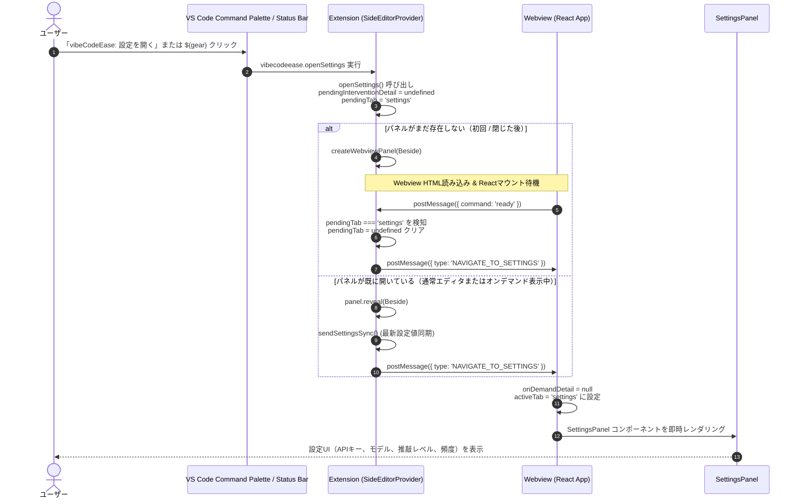

# 詳細仕様書: 専用コマンド「vibeCodeEase: 設定を開く」新設 (Step 2)

## 1. 概要と目的
本仕様書は、非侵襲オンデマンド・インラインUI/UX環境において、ユーザーがいつでもGemini APIキー、LLMモデル、推敲頻度・間隔等の設定を直接管理できるよう、専用コマンド `vibecodeease.openSettings`（タイトル: `vibeCodeEase: 設定を開く`）の新設およびVS Codeステータスバーへの設定アイコン追加を行うための詳細仕様を定義する。

---

## 2. アーキテクチャとメッセージフロー



---

## 3. ファイル別詳細変更仕様

### 3.1 `package.json`
- `contributes.commands` 配列に以下を追記：
  ```json
  {
    "command": "vibecodeease.openSettings",
    "title": "vibeCodeEase: 設定を開く"
  }
  ```

### 3.2 `src/types/webviewMessage.ts` & `webview-ui/src/types.ts`
- `ExtensionToWebviewMessage` ユニオン型に以下を追加：
  ```typescript
  | { type: 'NAVIGATE_TO_SETTINGS' }
  ```

### 3.3 `src/vscode-utils/StatusBar.ts` (`VibeStatusBar`)
- クラスフィールド追加:
  ```typescript
  private settingsStatusBarItem: vscode.StatusBarItem;
  ```
- コンストラクタ内での初期化:
  ```typescript
  this.settingsStatusBarItem = vscode.window.createStatusBarItem(
      vscode.StatusBarAlignment.Right,
      99,
  );
  this.settingsStatusBarItem.name = 'vibeCodeEase Settings';
  this.settingsStatusBarItem.command = 'vibecodeease.openSettings';
  this.settingsStatusBarItem.text = '$(gear) vibeCodeEase: 設定';
  const md = new vscode.MarkdownString();
  md.supportThemeIcons = true;
  md.appendMarkdown(
      '**vibeCodeEase: 設定**\n\nAPIキー、モデル選択、推敲設定を開く\n\n---\n*$(mouse-left) クリックで設定を開く*',
  );
  this.settingsStatusBarItem.tooltip = md;
  this.settingsStatusBarItem.show();
  ```
- `dispose()` 内で `this.settingsStatusBarItem.dispose()` を実行。

### 3.4 `src/vscode-utils/SideEditorProvider.ts`
- プロパティ追加:
  ```typescript
  private pendingTab?: 'code' | 'settings';
  ```
- メソッド更新 (`handlePanelDispose`):
  ```typescript
  private handlePanelDispose(): void {
      this.panel = undefined;
      this.pendingTab = undefined;
      this.pendingInterventionDetail = undefined;
      while (this.panelDisposables.length) {
          this.panelDisposables.pop()?.dispose();
      }
  }
  ```
- 新設メソッド (`openSettings`):
  ```typescript
  /**
   * [Why/Intent] 設定パネルをWebview右側（Beside）に直接表示する。
   * パネル未作成時は作成後に ready ハンドシェイクで NAVIGATE_TO_SETTINGS を送信し、
   * 既に存在する場合は reveal の上で即座に最新設定を同期し NAVIGATE_TO_SETTINGS をディスパッチする。
   * マウント前連続実行によるフラグ消失レースコンディションを完全防止する。
   */
  public async openSettings(): Promise<void> {
      this.pendingInterventionDetail = undefined;
      this.pendingTab = 'settings';
      if (!this.panel) {
          await this.openSideEditor();
      } else {
          this.panel.reveal(vscode.ViewColumn.Beside);
          void this.sendSettingsSync();
          void this.panel.webview.postMessage({ type: 'NAVIGATE_TO_SETTINGS' });
      }
  }
  ```
- `handleMessage` 内の `command === 'ready'` 分岐更新:
  ```typescript
  if (cmd === 'ready') {
      if (this.pendingTab === 'settings' && this.panel) {
          this.panel.webview.postMessage({ type: 'NAVIGATE_TO_SETTINGS' });
          this.pendingTab = undefined;
      } else if (this.pendingInterventionDetail && this.panel) {
          this.panel.webview.postMessage({
              type: 'EXPAND_INTERVENTION_DETAIL',
              payload: {
                  interventionId: this.pendingInterventionDetail.id,
                  persona: this.pendingInterventionDetail.personaId,
                  detail: this.pendingInterventionDetail,
              },
          });
      }
  }
  ```

### 3.5 `src/extension.ts`
- `registerExtensionCommands` 内で `vibecodeease.openSettings` を登録:
  ```typescript
  vscode.commands.registerCommand('vibecodeease.openSettings', () => {
      void sideEditorProvider.openSettings();
  }),
  ```

### 3.6 `webview-ui/src/App.tsx`
- メッセージハンドラ内の `switch (message.type)` に追加:
  ```typescript
  case 'NAVIGATE_TO_SETTINGS':
      setOnDemandDetail(null);
      setActiveTab('settings');
      break;
  ```

---

## 4. 異常系・エッジケース詳細定義

1. **オンデマンド介入詳細（OnDemandSidePanel）表示中に「設定を開く」が実行された場合**:
   - `openSettings` が実行され、Webviewへ `NAVIGATE_TO_SETTINGS` が届く。
   - `setOnDemandDetail(null)` により介入詳細モードが解除され、`setActiveTab('settings')` により即座に `SettingsPanel` に切り替わる。
   - 拡張機能側も `this.pendingInterventionDetail = undefined;` となるため、不意の再展開は発生しない。
2. **Webviewパネルが閉じられている状態からの連続実行（マウント前連打）**:
   - 1回目の実行で `pendingTab = 'settings'` となり Webview 生成開始。
   - 2回目の実行時も `pendingTab = 'settings'` が維持され、パネルに対して `reveal` と `NAVIGATE_TO_SETTINGS` が送信される。
   - Webview 側は `ready` 送信後に `pendingTab === 'settings'` をトリガーとして `NAVIGATE_TO_SETTINGS` を確実に受け取り、正常に設定タブが表示される。
3. **Webview生成途中でパネルが閉じられた場合（即時Dispose）**:
   - `handlePanelDispose()` で `pendingTab = undefined` および `pendingInterventionDetail = undefined` が確実にクリアされるため、次回の起動に意図しない状態が持ち越されることはない。
4. **拡張機能の Deactivate / Dispose 時**:
   - `VibeStatusBar.dispose()` により `statusBarItem` および `settingsStatusBarItem` が安全に破棄される。

---

## 5. 4レイヤーテスト計画

### レイヤー 1: フロントエンド単体テスト (`webview-ui/src/App.test.tsx`)
- **テストケース 1**: `NAVIGATE_TO_SETTINGS` メッセージを受信した際、`activeTab` が `'settings'` に更新され、`SettingsPanel` が描画されること。
- **テストケース 2**: `onDemandDetail` が表示されている状態（オンデマンド展開中）で `NAVIGATE_TO_SETTINGS` を受信した際、`onDemandDetail` が `null` に解除され、`SettingsPanel` が描画されること。

### レイヤー 2: 拡張機能単体テスト (`src/test/statusBar.test.ts`)
- **テストケース 1**: `VibeStatusBar` インスタンス化時に、`settingsStatusBarItem` が priority 99、alignment Right、command `'vibecodeease.openSettings'`、text `'$(gear) vibeCodeEase: 設定'` で生成・表示されること。
- **テストケース 2**: `dispose()` 呼び出し時に、両方の StatusBarItem が破棄されること。

### レイヤー 3: 結合テスト (`src/test/sideEditorProviderSettings.test.ts`)
- **テストケース 1 (パネル非存在時)**: `openSettings()` 呼び出しでパネルが作成され、Webview から `{ command: 'ready' }` を受信したときに `{ type: 'NAVIGATE_TO_SETTINGS' }` が postMessage されること。
- **テストケース 2 (パネル存在時)**: 既にパネルが存在する場合に `openSettings()` を呼び出すと、即座に `{ type: 'NAVIGATE_TO_SETTINGS' }` が postMessage され、パネルが `reveal` されること。
- **テストケース 3 (レースコンディション検証)**: Webviewマウント完了前に `openSettings()` が連続呼び出しされても `pendingTab === 'settings'` が維持され、`ready` 受信時に正常にメッセージが送信されること。

### レイヤー 4: E2E テスト (`webview-ui/e2e/open-settings-command.spec.ts`)
- **テストケース 1**: Webview 上で `window.postMessage({ type: 'NAVIGATE_TO_SETTINGS' }, '*')` を発火した際、即座に設定画面が表示され、Gemini APIキー入力欄、推敲レベル、モデル選択ドロップダウンが表示されることを検証。
- **コンソールエラー検証**: コンソールエラーが 0 件であることを確認。
