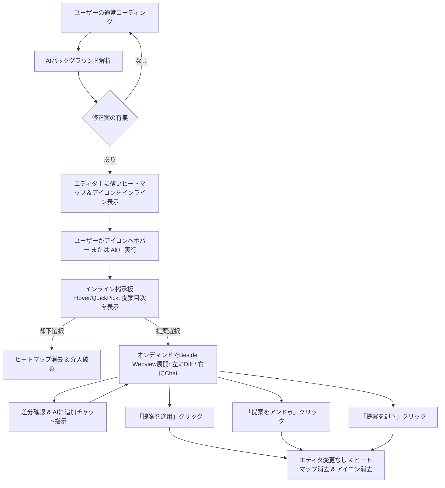

# 要件定義書: 非侵襲オンデマンド・インラインAIコーディングアシスタント (vibeCodeEase)

## 1. 概要と基本コンセプト

### 1.1 背景と課題
従来のAIコーディングアシスタントは、常設のサイドバーや過度な自動コード書き換えにより、開発者の集中（ゾーン状態）を妨げ、作業スペースを圧迫するという課題（侵襲性）がありました。

### 1.2 コアコンセプト
**「エディタ中心主義 ＆ オンデマンド展開」**
- 常設の「AIワークスペース」サイドバーを完全撤廃し、普段はユーザーのコーディング作業（メインエディタ）を主役に据える。
- AIの提案は、エディタ上の対象コード箇所に「薄いヒートマップ」と「控えめなアイコン」でのみインライン示唆する。
- ユーザーが「詳細を知りたい」と要求した時だけ、初めてサイドパネルを左右分割（左: GitHub風Diff / 右: AIチャットペイン）でオンデマンド展開する。

---

## 2. 画面構成イメージ（GUIワイヤーフレーム）

### 2.1 全体画面レイアウト（VS Code ウィンドウ全体）

```text
+---------------------------------------------------------------------------------------------------------+
| Visual Studio Code                                                                                      |
|---------------------------------------------------------------------------------------------------------|
| [メインテキストエディタ (Main Editor)]                  | [オンデマンド AI Side Editor (Beside Webview)]   |
|                                                        | ※普段は非表示。目次から詳細要求時のみ開く       |
| 10 | function calculateTotal(items: CartItem[]) {      | +-------------------------+-------------------+|
| 11 |     let total = 0;                                | | 左カラム:               | 右カラム:         ||
| 12 | 💡 ~~~ items.forEach(item => { ~~~~~~~~~~~~~~~~~~ | | GithubDiffView (Diff)   | Chat & 操作ペイン ||
| 13 |          total += item.price * item.quantity;     | |                         |                   ||
| 14 | ~~~~ }); ~~~~~~~~~~~~~~~~~~~~~~~~~~~~~~~~~~~~~~~~ | |                         |                   ||
| 15 |     return total;                                 | |                         |                   ||
| 16 | }                                                 | |                         |                   ||
|    |                                                   | +-------------------------+-------------------+|
+---------------------------------------------------------------------------------------------------------+
```

### 2.2 デフォルト状態（メインエディタのみ・AIサイドバー非表示）
普段のコーディング時はサイドバーを閉じ、エディタ上にのみ介入候補を薄く示唆する。

```text
+----------------------------------------------------------------------------------+
| VS Code Main Editor                                            [Sidebar: Closed] |
|----------------------------------------------------------------------------------|
| 10 | function calculateTotal(items: CartItem[]): number {                       |
| 11 |     let total = 0;                                                         |
| 12 | [💡] ~~~ items.forEach(item => { ~~~~~~~~~~~~~~~~~~~~~~~~~~~~~~~~ (薄いヒートマップ)|
| 13 |          total += item.price * item.quantity;                               |
| 14 | ~~~~ }); ~~~~~~~~~~~~~~~~~~~~~~~~~~~~~~~~~~~~~~~~~~~~~~~~~~~~~~~~           |
| 15 |     return total;                                                          |
| 16 |                                                                            |
| 17 | [✓] function formatCurrency(val: number): string { // (確認済み: 弱アイコン・色なし)|
+----------------------------------------------------------------------------------+
```

### 2.3 サマリー確認状態（インライン小規模掲示板 / 目次ポップアップ）
VS CodeのAPI制約（ガターアイコン直接クリックイベント不可、行間への任意HTML挿入不可）を踏まえ、以下の**デュアル・トリガー方式**を採用する：
- **トリガー方式A（Hover/アイコンツールチップ）**: `[💡]` アイコンまたはハイライト行にマウスホバーした際に、VS CodeネイティブのHoverポップアップ（Markdown掲示板）を表示。クリック可能な `command:` リンクで提案詳細を展開可能。
- **トリガー方式B（QuickPick目次）**: ショートカットキー（`Alt+I`）またはコマンド実行（`vibeCodeEase: Show Intervention Summary`）により、エディタ上部に目次セレクタを表示。

```text
【トリガーA: HoverProvider によるインライン掲示板ポップアップ】
+----------------------------------------------------------------------------------+
| 12 | [💡] items.forEach(item => {                                               |
|    | +-----------------------------------------------------------------------+  |
|    | | 💬 **vibeCodeEase: AI介入サマリー (2件の提案)**                      |  |
|    | |-----------------------------------------------------------------------|  |
|    | | 1. ⚡ **[パフォーマンス改善]** forEachをreduceに変更                  |  |
|    | |    配列集計処理をより宣言的かつ高速にリファクタリング可能です。       |  |
|    | |    👉 [詳細差分と対話を開く](command:vibecodeease.expandIntervention?1)|  |
|    | |                                                                       |  |
|    | | 2. 🛡️ **[null安全対策]** item.quantity の未定義チェックを追加          |  |
|    | |    quantityがundefinedの場合に発生する潜在的NaNを回避します。         |  |
|    | |    👉 [詳細差分と対話を開く](command:vibecodeease.expandIntervention?2)|  |
|    | |-----------------------------------------------------------------------|  |
|    | | ❌ [この提案をすべて却下する](command:vibecodeease.discardIntervention) |  |
|    | +-----------------------------------------------------------------------+  |
| 13 |          total += item.price * item.quantity;                               |
+----------------------------------------------------------------------------------+

【トリガーB: QuickPick による目次セレクタ】
+----------------------------------------------------------------------------------+
| > 💬 AI提案の目次を選択してください: (該当箇所: L12-L14)                         |
|----------------------------------------------------------------------------------|
| $(zap) 1. [パフォーマンス改善] forEachをreduceに変更 - 配列走査を宣言的に改善     |
| $(shield) 2. [null安全対策] item.quantityのチェック追加 - NaN潜在リスクの回避    |
| $(trash) 3. この提案を却下する (Dismiss)                                         |
+----------------------------------------------------------------------------------+
```

### 2.4 詳細展開時UI（単一Webviewパネル内の左右2カラム構成）
目次内の提案をクリックした瞬間に初めてサイドパネル（`vscode.ViewColumn.Beside`）が開き、単一Webview内に以下の2カラムUIが表示される。

```text
+----------------------------------------------------+------------------------------------+
| 左カラム: GithubDiffView (Before/After)            | 右カラム: AIチャット＆操作ペイン (Chat)    |
|----------------------------------------------------+------------------------------------|
| [1/2] パフォーマンス改善: forEach ➜ reduce        | 👤 ペルソナ: [ シニア (簡潔) ▼ ]   [✖ 閉じる] |
|----------------------------------------------------+------------------------------------|
| 12 - items.forEach(item => {                       | 🤖 AIアシスタント:                  |
| 13 -     total += item.price * item.quantity;      | 配列集計をreduceに集約しました。   |
| 14 - });                                           | 局所変数のミューテーションを排除し |
| 12 + return items.reduce((acc, item) => {          | 副作用のない安全な記述にします。   |
| 13 +     return acc + (item.price * item.qty);     |------------------------------------|
| 14 + }, 0);                                        | 🛠️ アクション:                     |
|                                                    | [⏪ 提案を取り消す (アンドゥ)]      |
|                                                    | [⏩ この提案を適用する (復元)]     |
|                                                    | [🗑️ 提案を却下 (Dismiss)]         |
|                                                    |------------------------------------|
|                                                    | 💬 AIと対話・追加指示:             |
|                                                    | +--------------------------------+ |
|                                                    | | for-ofループ版のコードも見せて  | |
|                                                    | +--------------------------------+ |
|                                                    | [ 送信 (Enter) ]                   |
+----------------------------------------------------+------------------------------------+
```

---

## 3. インタラクション・フロー（UX）要件



### 3.1 介入の示唆
- AI解析完了時、修正候補が存在する行・範囲に対して `TextEditorDecorationType` を適用。
- 背景色（ヒートマップ）: `rgba(255, 193, 7, 0.12)` （控えめで目に優しい薄いハイライト）。
- アイコン表示: `gutterIconPath`（電球アイコン `💡`）および行末インラインアイコンを表示。

### 3.2 サマリーの確認（インライン掲示板）
- アイコンまたは行にマウスホバーすると `vscode.languages.registerHoverProvider` によるインライン掲示板を表示。
- または、行上でショートカットキー（`Alt+I`）を押すと `vscode.window.showQuickPick` で目次リストを表示。
- 目次には各提案の一言サマリー（タイトル＋1行解説）を提示。

### 3.3 詳細の展開
- 目次をクリックした時点で、初めて `vscode.ViewColumn.Beside` に Webview パネルを展開。
- Webview 内で左側に `GithubDiffView`、右側に該当提案にフォーカスしたチャット・操作ペインを左右2カラムで描画。

### 3.4 対話の実行
- 右側チャットペインで、ユーザーは提示された Diff を見ながら「別パターンにして」「なぜこの変更が必要？」と追加チャット可能。
- 応答はペルソナ設定に基づいてトーンや文字数が調整されて表示される。

### 3.5 能動的指示（ユーザーからの逆指名フロー）
1. ユーザーがエディタ上で任意のコード範囲を選択。
2. 右クリックコンテキストメニューから「vibeCodeEase: ここを作業してコメント作成」を選択（またはコマンド実行）。
3. VS Codeの `vscode.window.showInputBox` がポップアップし、指示内容（例:「パフォーマンス改善して」「nullチェックを追加して」）を入力。
4. 入力された指示と選択コードを LLM Gateway に送り、推敲案とコメントを生成。
5. 生成された提案がインラインヒートマップおよび目次として登録され、即座に確認可能となる。

### 3.6 状態の視覚的フィードバック
- **未確認（Pending）**: 薄いヒートマップ（ハイライトあり） ＋ 通常電球アイコン `[💡]`。
- **適用済み（Applied）**: ヒートマップ消去 ＋ 弱アイコン（透過チェックマーク `[✓]` または半透明アイコン）。
- **アンドゥ済み（Reverted）**: ヒートマップ再表示 ＋ 通常アイコン `[💡]`（再適用可能な状態）。
- **却下（Dismissed）**: ヒートマップ消去 ＋ 装飾完全解除。

### 3.7 介入の操作（アンドゥと復元、却下）
- Webview 内の操作ペインに以下の3つの明示的なボタングループを常時配置：
  - `[⏪ 提案を取り消す (アンドゥ)]`: 適用済みのコード変更を介入前の元コードにロールバック。
  - `[⏩ この提案を適用する (復元)]`: 未適用またはアンドゥ済みの提案を現在のコードへ即座に再適用。
  - `[🗑️ 提案を却下 (Dismiss)]`: この提案を採用せず破棄し、装飾を消去。

---

## 4. パーソナライズとデータ管理要件

### 4.1 5種類のプリセットペルソナ定義

| ID (`PersonaId`) | ペルソナ名 | 目的・対象者 | メッセージ性とプロンプト方針 |
|:---|:---|:---|:---|
| `mentor` | 初心者向けメンター | プログラミング初学者・入門者 | 基礎概念から丁寧に解説し、なぜその修正が必要かをわかりやすく説明する。 |
| `concise` | シニア・コードオンリー | 上級エンジニア・急ぎの実装 | 冗長な解説を徹底的に省き、コード差分と技術的理由のみを最小限の文字数で提示する。 |
| `architect` | 設計・アーキテクト | リファクタ・クリーンコード志向 | 責務の分離、SOLID原則、拡張性、保守性の観点から設計上の改善案を深く提示する。 |
| `qa_security` | デバッグ・品質特化 | バグ修正・脆弱性対策 | 境界値、null例外、セキュリティ脆弱性、パフォーマンスボトルネックに特化して指摘する。 |
| `tutor` | 思考促進チューター | 理解を深めたい自習者 | 答えをすぐ与えず、ヒントや問いかけを交えながら自力で解決できるように誘導する。 |

Webview の右ペイン上部に「ペルソナ選択プルダウン」を設置し、ユーザーがいつでも切り替え可能とする。切り替え時は `SWITCH_PERSONA` メッセージを発行し、以降のチャットおよび提案生成に即時反映する。

### 4.2 データ型定義 (TypeScript)

```typescript
export type PersonaId = 'mentor' | 'concise' | 'architect' | 'qa_security' | 'tutor';

export type InterventionStatus = 'pending' | 'applied' | 'reverted' | 'dismissed';

export interface Position {
    line: number;
    character: number;
}

export interface Range {
    start: Position;
    end: Position;
}

export interface ChatMessage {
    id: string;
    sender: 'user' | 'ai';
    message: string;
    timestamp: string; // ISO 8601
}

export interface InterventionItem {
    id: string;
    title: string;
    summary: string;
    range: Range;
    status: InterventionStatus;
    personaId: PersonaId;
    createdAt: string;
    updatedAt: string;
}

export interface InterventionDetail extends InterventionItem {
    originalCode: string;
    proposedCode: string;
    chatHistory: ChatMessage[];
}

export interface DocumentInterventionHistory {
    version: '1.0.0';
    documentUri: string;
    interventions: InterventionDetail[];
}
```

### 4.3 履歴のJSON永続化
ワークスペースの `.vscode/vibecodeease/history.json`（または `context.workspaceState`）に、上記 `DocumentInterventionHistory` 構造で永続化する。VS Code 再起動後も過去の介入・チャットログ・適用/アンドゥ状態を復元可能とする。

---

## 5. API / IPC メッセージ契約 (I/O仕様と具体例)

### 5.1 拡張機能 (Extension) ➜ Webview

#### ① `EXPAND_INTERVENTION_DETAIL`
目次で提案が選択された時、または詳細展開要求時に、Webviewへ差分とチャット履歴を送信する。
```json
{
  "type": "EXPAND_INTERVENTION_DETAIL",
  "payload": {
    "interventionId": "int-20261105-001",
    "persona": "concise",
    "detail": {
      "id": "int-20261105-001",
      "title": "forEachをreduceに変更",
      "summary": "配列走査を宣言的に集約し局所変数のミューテーションを排除",
      "range": {
        "start": { "line": 12, "character": 4 },
        "end": { "line": 14, "character": 7 }
      },
      "status": "pending",
      "personaId": "concise",
      "originalCode": "items.forEach(item => {\n    total += item.price * item.quantity;\n});",
      "proposedCode": "return items.reduce((acc, item) => {\n    return acc + (item.price * item.quantity);\n}, 0);",
      "createdAt": "2026-11-05T12:00:00.000Z",
      "updatedAt": "2026-11-05T12:00:00.000Z",
      "chatHistory": [
        {
          "id": "msg-001",
          "sender": "ai",
          "message": "配列走査をreduceに集約しました。副作用のない宣言的な集計処理になります。",
          "timestamp": "2026-11-05T12:00:00.000Z"
        }
      ]
    }
  }
}
```

#### ② `RECEIVE_CHAT_MESSAGE`
ユーザーのチャット送信に対し、AI（LLM）からの応答メッセージをWebviewへ配信する。
```json
{
  "type": "RECEIVE_CHAT_MESSAGE",
  "payload": {
    "interventionId": "int-20261105-001",
    "message": {
      "id": "msg-002",
      "sender": "ai",
      "message": "for-ofループ版の場合は以下のようになります：\n```ts\nfor (const item of items) {\n    total += item.price * item.quantity;\n}\n```",
      "timestamp": "2026-11-05T12:01:15.000Z"
    }
  }
}
```

#### ③ `SYNC_HISTORY_STATE`
介入一覧のステータス（適用済、アンドゥ済、却下）が変化した際にWebview全体へ同期する。
```json
{
  "type": "SYNC_HISTORY_STATE",
  "payload": {
    "documentUri": "file:///c:/project/cart.ts",
    "interventions": [
      {
        "id": "int-20261105-001",
        "title": "forEachをreduceに変更",
        "summary": "配列走査を宣言的に集約",
        "range": { "start": { "line": 12, "character": 4 }, "end": { "line": 14, "character": 7 } },
        "status": "applied",
        "personaId": "concise",
        "createdAt": "2026-11-05T12:00:00.000Z",
        "updatedAt": "2026-11-05T12:02:00.000Z"
      }
    ]
  }
}
```

---

### 5.2 Webview ➜ 拡張機能 (Extension)

#### ① `APPLY_INTERVENTION`
ユーザーが「提案を適用する (復元)」ボタンを押した時に発行。
```json
{
  "type": "APPLY_INTERVENTION",
  "payload": {
    "interventionId": "int-20261105-001"
  }
}
```

#### ② `UNDO_INTERVENTION`
ユーザーが「提案を取り消す (アンドゥ)」ボタンを押した時に発行。
```json
{
  "type": "UNDO_INTERVENTION",
  "payload": {
    "interventionId": "int-20261105-001"
  }
}
```

#### ③ `DISCARD_INTERVENTION`
ユーザーが「提案を却下 (Dismiss)」ボタンを押した時に発行。
```json
{
  "type": "DISCARD_INTERVENTION",
  "payload": {
    "interventionId": "int-20261105-001"
  }
}
```

#### ④ `SEND_CHAT_MESSAGE`
ユーザーが右ペインのチャット入力欄からメッセージを送信した時に発行。
```json
{
  "type": "SEND_CHAT_MESSAGE",
  "payload": {
    "interventionId": "int-20261105-001",
    "personaId": "concise",
    "text": "for-ofループ版のコードも見せて"
  }
}
```

#### ⑤ `SWITCH_PERSONA`
ユーザーがペルソナ選択プルダウンを変更した時に発行。
```json
{
  "type": "SWITCH_PERSONA",
  "payload": {
    "personaId": "architect"
  }
}
```

#### ⑥ `REQUEST_ACTIVE_INTERVENTION`
Webviewまたはコマンドから能動的解析（逆指名）を要求した時に発行。
```json
{
  "type": "REQUEST_ACTIVE_INTERVENTION",
  "payload": {
    "range": {
      "start": { "line": 20, "character": 0 },
      "end": { "line": 35, "character": 1 }
    },
    "instruction": "この関数をSOLID原則の単一責任原則に従ってリファクタリングして"
  }
}
```

---

## 6. プロジェクト制約・ルールとの整合性と事前承認事項

### 6.1 `project-rules.md` 第1条の改定方針
- **背景**:
  既存の `.agents/rules/project-rules.md` 第1条には「左エディタへの直接的な CodeAction やインラインデコレーションの追加は行わない」という規定が存在します。これは以前、過度な自動コード変更や煩わしい装飾がコーディングを妨害したために設けられた防護ルールです。
- **改定の必要性と方針**:
  本要件定義では「ユーザーの作業を邪魔しない非侵襲な薄いヒートマップと控えめなアイコン示唆」を導入するため、本機能の実装に着手する前提として、ユーザー（人間）の明示的許可を得た上で、`project-rules.md` 第1条を以下のように改定・更新します：
  > 「左エディタへの直接的な無断コード書き換えや侵襲的UIは排除する。ただし、非侵襲な薄いヒートマップ装飾および控えめなアイコンによるオンデマンド示唆（`InlineInterventionDecorator`）は許可する。」
